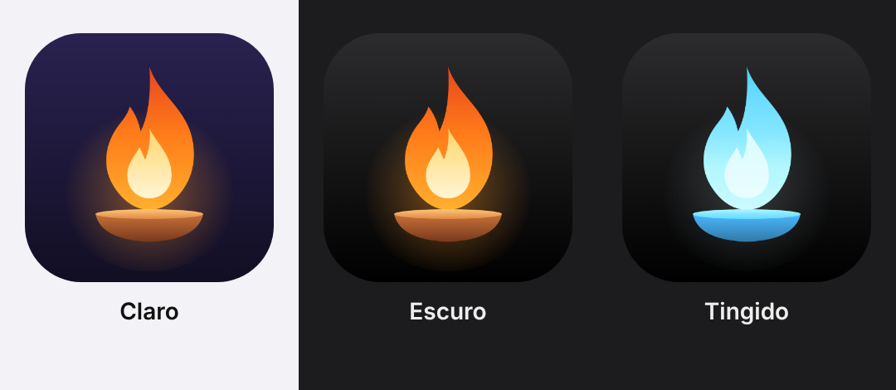

# 灯火 Tomoshibi



"Chama da lamparina" em japonês. App de iPhone que cuida das suas tarefas e da sua rotina, com o Claude como assistente.
Feito para uso pessoal, instalado fora da App Store com conta Apple grátis.

## O que faz

- **Hoje**: o que fazer agora, atrasadas, tarefas do dia, próximos dias. Deslize para concluir, adiar ou apagar.
- **Assistente**: conversa com o Claude, que lê e mexe nas suas tarefas. "Planejar meu dia" monta o plano encaixando horários e prioridades.
- **Memória**: o assistente guarda o que aprende sobre você (rotina, preferências, metas) e usa em toda conversa. Dá pra ver e editar em Ajustes.
- **Conversa contínua**: o histórico fica salvo; o contexto enviado ao Claude recomeça a cada dia e a memória faz a ponte.
- **Notificações**: resumo da manhã (escrito pelo Claude quando o iOS deixa o app rodar em segundo plano), check-in da noite e aviso na hora de cada tarefa, com botões Feito, Adiar 1h e Amanhã. Tocar no resumo ou no check-in abre a conversa já no assunto.
- **Siri**: "Anotar no Tomoshibi" cria uma tarefa para hoje.
- Tarefas que repetem (todo dia, dias úteis, toda semana).
- **Gastos**: puxa as transações dos seus bancos pelo Meu Pluggy (Open Finance, só leitura) ou de um extrato OFX/CSV. Mostra quanto gastou no período, por categoria e dia a dia, e o assistente analisa ("quanto foi de iFood esse mês?").

Os dados ficam só no iPhone (SwiftData). As chaves (Claude e Pluggy) ficam no Keychain.

## Instalar (sem pagar a Apple)

Com a conta Apple grátis o app vale 7 dias. O SideStore renova sozinho pelo Wi-Fi, então na prática ele fica.

### Opção A: SideStore (recomendado)

1. Instale o SideStore no iPhone seguindo [docs.sidestore.io](https://docs.sidestore.io). É preciso o Mac uma única vez.
2. Pegue o `Assistente.ipa`:
   - na aba **Actions** do GitHub, último build, artefato `Assistente-ipa`; ou
   - no Mac: `brew install xcodegen && scripts/gerar-ipa.sh`.
3. Abra o `.ipa` no SideStore. Ele assina com sua conta e renova a cada poucos dias em segundo plano.

### Opção B: direto pelo Xcode

1. `brew install xcodegen && xcodegen generate`
2. Abra `Assistente.xcodeproj`, em **Signing & Capabilities** escolha seu **Personal Team**.
   Se reclamar do bundle id, troque `com.caiogobbi.assistente` por outro único.
3. No iPhone: **Ajustes > Privacidade e Segurança > Modo de Desenvolvedor** ligado.
4. Plugue o iPhone e dê Run. Na primeira vez, confie no perfil em **Ajustes > Geral > VPN e Gerenciamento de Dispositivos**.

Nesse modo, a cada 7 dias é só dar Run de novo; os dados continuam.

## Configurar

Na aba **Ajustes**: seu nome, a chave da API do Claude ([console.anthropic.com](https://console.anthropic.com), cobrada por uso) e os horários do resumo e do check-in.
O modelo padrão é o Opus 5.5; o Haiku 5.5 sai bem mais barato se quiser economizar.

### Banco (Meu Pluggy, grátis)

1. Crie uma conta em [dashboard.pluggy.ai](https://dashboard.pluggy.ai) e uma **aplicação**. Copie o **Client ID** e o **Client Secret**.
2. Em [meu.pluggy.ai](https://meu.pluggy.ai), conecte seus bancos. É o Open Finance oficial: você autoriza no app do banco e o acesso é só de leitura.
3. No dashboard: **Aplicações** > sua aplicação > página **Demo** > **Conectar Conta** > escolha **MeuPluggy** (aba Direct Connectors) e entre com a conta do Meu Pluggy.
4. Ainda na Demo, em **Itens Conectados**, clique em cada item e copie o **itemId**. Cada banco vira um item.
5. No app, **Ajustes > Banco**: cole Client ID, Secret e os Item IDs (separados por vírgula) e toque em **Testar conexão**.

A aba **Gastos** sincroniza sozinha a cada 6 horas (ou puxe a lista para baixo). Na primeira vez traz os últimos 90 dias.
Pagamento de fatura fica fora dos totais, porque as compras já contam no cartão.

Sem Pluggy, dá para usar **Importar extrato**: exporte o extrato em OFX ou CSV no app ou site do banco e escolha o arquivo.
Importar o mesmo arquivo de novo não duplica nada.

## Código

```
Assistente/
  App/        entrada do app, preferências, formatos de data
  Modelos/    Tarefa e Transacao (SwiftData), Agenda (como o dia é dividido)
  Servicos/   clientes do Claude e da Pluggy, extrato OFX/CSV, ferramentas, laço do assistente, notificações, Keychain
  Telas/      Hoje, Gastos, Assistente, Ajustes, edição de tarefa
  Intents/    atalho da Siri
project.yml   projeto do XcodeGen (o .xcodeproj é gerado, não vai pro git)
```
